### ✨ Full-Stack Developer & MERN Stack Specialist ✨

  
  
  

---

### 🚀 About Me
- 🌱 I’m currently pursuing a **BS in Computer Science** at COMSATS University Islamabad, Vehari Campus.
- 💻 Specialized in full-stack web development with extensive expertise in the **MERN stack** (MongoDB, Express.js, React.js, Node.js), Python, and modern CSS frameworks.
- 🛠️ Experienced in building scalable web applications, REST APIs, real-time collaboration tools, and configuring web analytics tools like Google Tag Manager and Meta Pixel.
- 🚀 Founder of the apparel brand **"Ezhan Wears"** and creator of trading platform landing pages like **"Trading Movers"** and **"MU Trader"**.

---

### 🛠️ Technical Arsenal

| Category | Technologies & Tools |
| :--- | :--- |
| **Frontend** | HTML5, CSS3, JavaScript (ES6+), React.js, Bootstrap, Tailwind CSS |
| **Backend & APIs** | Node.js, Express.js, Python, REST APIs, WebSockets, Yjs CRDTs |
| **Databases & Storage** | MongoDB, MongoDB Compass, Redis |
| **DevOps & Tools** | Git, GitHub, VS Code, Jupyter Notebook, Docker, Vercel, Netlify, Hostinger hPanel |
| **Analytics & Tracking** | Google Tag Manager (GTM), Meta Pixel, Custom Event Triggers |

---

### 💼 Featured Projects & Experience

* **Parallax Labs Collaboration SaaS (2026):** Developed real-time collaboration features using Yjs CRDTs, WebSockets, and Redis caching for a SaaS booking platform.
* **AI Resume Screening (2026):** Built a machine learning text-classification project in Jupyter Notebook using Python models trained on dataset records (`UpdatedResumeDataSet.csv`).
* **Face Recognition Secure Vault (2026):** Engineered a Python-based Information Security semester project focusing on biometric authentication and secure data vaults.
* **Frontend Developer Internship - CodeAlpha (2025):** Constructed responsive web applications including an interactive portfolio, image gallery, and food ordering website.
* **E-commerce & Landing Pages:** Founded **Ezhan Wears** and designed production landing pages for **Trading Movers** and **MU Trader** (`mutrader.com`).

---

### 📊 GitHub Stats & Activity

  
    
  

---

### 🌐 Connect With Me

  
  

 

  <em>⚡ "Building digital experiences with clean code and creative design."</em>

